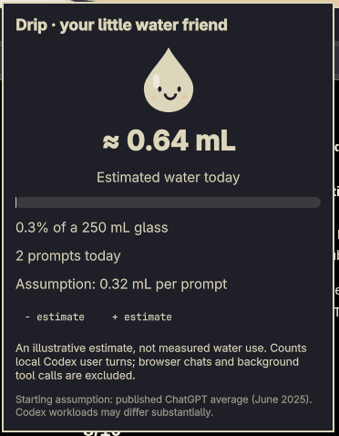

# Drip 💧

**A tiny dancing water friend for your Omarchy bar.**

Drip is a theme-aware [Omarchy](https://omarchy.org/) bar widget that counts **local Codex user turns** and displays an **illustrative estimate** of their associated water use. A smiling droplet lives in the bar; click it to open a panel with today's estimated volume, prompt count, a 250 mL glass gauge, and controls for adjusting the estimate.

The droplet animates while detected Codex turns are active and perks up when a new turn arrives. It respects reduced-motion settings. The panel follows Omarchy's theme.

> **Not a water meter.** Drip estimates water use from a configurable per-prompt assumption; it does not measure data-center consumption or establish the footprint of your specific Codex workload.

## Screenshots

**Compact bar widget** — a small droplet and today's estimated water use in the Omarchy bar.


**Expanded detail panel** — the droplet, daily prompt count, 250 mL glass gauge, and adjustable estimate.



## What it shows

- **Today's prompts:** qualifying user-initiated Codex turns found in local session logs.
- **Estimated water:** today's count multiplied by the configured mL-per-prompt assumption.
- **Glass gauge:** progress against an illustrative 250 mL glass.
- **Activity animation:** a dancing droplet when active turns are detected. Inactive/abandoned activity expires after five minutes without log updates.

The default assumption is **0.32 mL per prompt**, rounded from the 0.000085 US gallons per average ChatGPT query mentioned in [*The Gentle Singularity*](https://blog.samaltman.com/the-gentle-singularity) (June 2025). That figure is **not a validated Codex- or model-specific measurement**. Reasoning depth, tool calls, hardware, location, and accounting methodology may change real-world consumption substantially. The +/- controls adjust the assumption and recalculate the displayed estimate.

## Install

**Requirements:** Omarchy with its Quickshell bar, Qt 6 Core development tools, `qmake6`, `make`, a C++17 compiler, and Python 3.

The installer **modifies your user Omarchy configuration**, so review it before running it. It builds the CLI, runs the automated tests, validates the plugin, stages the files, and registers `tlindsey.drip` in the bar layout. It creates a timestamped backup of `shell.json` and preserves the previous plugin directory on upgrades.

```bash
git clone https://github.com/teufelziege/drip.git
cd drip
./bin/install
omarchy restart shell
```

**Development branch:** Until [PR #1](https://github.com/teufelziege/drip/pull/1) is merged, the reliability fixes and expanded tests are on `fix/reliability-pass`, **not** the default branch. To try that version, use `git clone --branch fix/reliability-pass https://github.com/teufelziege/drip.git` instead.

For prerequisites, a build-only path, upgrades, backups, troubleshooting, and manual removal, see **[Installation & recovery](docs/INSTALL.md)**.

## Build and test without installing

```bash
./bin/build
python3 -m unittest discover -s tests -p 'test_*.py' -v
./build/drip
```

The CLI prints JSON, including `prompts`, `ml`, `rate`, `running`, and `unreadable`. Running it reads your local Codex logs and writes its own state file, but **does not install the bar plugin**. `./build/drip --rate 0.32` sets the assumption; `--sessions DIR --state FILE` support isolated tests.

## How counting works

Drip reads `~/.codex/sessions/**/*.jsonl` and counts `event_msg/task_started` events with `turn_attribution.turn_trigger == "user"` and a turn ID. Events are deduplicated per session path and turn ID. It excludes agent-initiated/background turns and does **not** count browser ChatGPT, other machines, or every possible Codex interaction format. Dates use your **local timezone**, even when session timestamps are UTC. The widget polls every three seconds, and existing qualifying turns from today are included at first launch.

The CLI stores event IDs, timestamps, file offsets, activity metadata, and your chosen assumption in `~/.local/state/drip/state.json`. It does **not** store prompt text or send network requests. It scans existing logs initially and subsequently processes appended data. No separate daemon is installed. An `unreadable` value of zero means no file-read errors were detected; it does not by itself prove that any logs were found.

## Privacy and limitations

- **Local-only:** no account login, API key, telemetry, or outbound network calls.
- **Illustrative estimate:** not a direct measurement of water use.
- **Format-dependent:** future Codex session-log changes may require parser updates.
- **Activity is best-effort:** abandoned turns time out; it is not a process supervisor.
- **Daily count:** resets according to the local calendar date, not UTC.

## License

MIT — see [LICENSE](LICENSE).
